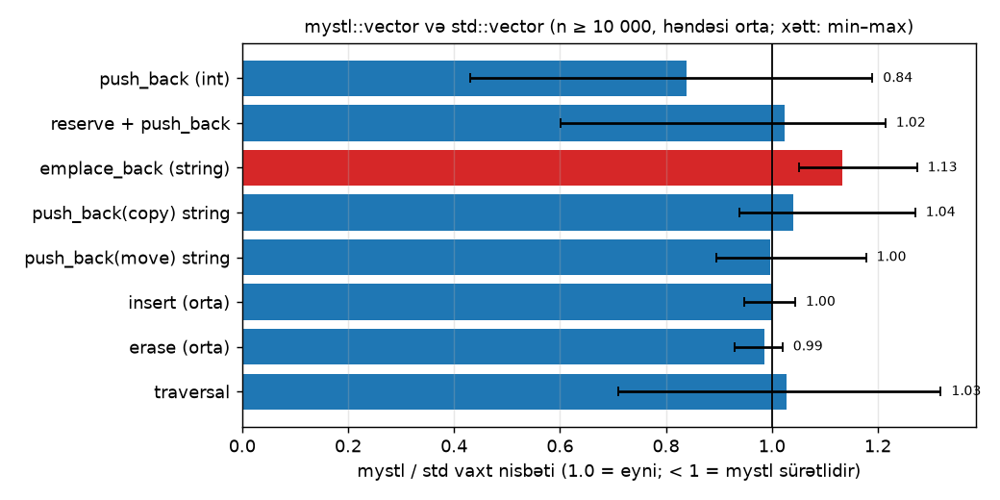

# mystl::vector — C++-da `std::vector` sıfırdan

C++20-də `std::vector`-un tam işlək analoqu. Layihə testlər, sanitizer-lər və benchmark ilə yoxlanılır.

```cpp
#include <mystl/vector.hpp>

mystl::vector<std::string> v{"b", "c"};
v.insert(v.begin(), "a");
v.emplace_back(3, 'x');                    // "xxx", birbaşa yerində qurulur
mystl::erase_if(v, [](const auto& s) { return s.size() > 2; });

mystl::vector<int, mystl::growth::one_and_half> w;   // 1.5× böyümə siyasəti
```

## Vəziyyət

| Faza | Addım | Vəziyyət |
|---|---|---|
| 0 | Repo skeleti, CMake, doctest, ilk test | ✅ |
| A0 | Obyektin ömrü: `Noisy` təcrübəsi | ✅ |
| A1 | v1: `IntVector` | ✅ |
| A2 | v2: kopyalama, rule of three | ✅ |
| A3 | v3: template `mystl::vector<T>` | ✅ |
| A4 | v4: xam yaddaş, placement new | ✅ |
| A5 | v5: move semantics, rule of five | ✅ |
| B1 | Elementə giriş və iterator-lar | ✅ |
| B2 | Constructor-lar və mənimsəmə | ✅ |
| B3 | Tutum: `resize`, `shrink_to_fit`, `max_size` | ✅ |
| B4 | Modifikatorlar: `emplace`, `insert`, `erase` | ✅ |
| B5 | Müqayisə operatorları, `swap(a, b)` | ✅ |
| B6 | Growth policy, iterator invalidation cədvəli | ✅ |
| C | Testlər, differential test, coverage | ✅ |
| C | ASan + UBSan Linux-da | ⏳ |
| D | Benchmark və 7 tədqiqat sualı | ✅ |

## İnterfeys

`std::vector`-un interfeysi tam dəstəklənir, yalnız **custom allocator** və **`vector<bool>`** ixtisaslaşması bilərəkdən əhatə xaricindədir.

| Qrup | Metodlar |
|---|---|
| Constructor-lar | default, `(n)`, `(n, value)`, `(first, last)`, `({...})`, copy, move |
| Mənimsəmə | `operator=` (copy, move, `{...}`), `assign` |
| Giriş | `at`, `operator[]`, `front`, `back`, `data` |
| Iterator-lar | `begin`/`end`, `cbegin`/`cend`, `rbegin`/`rend`, `crbegin`/`crend` |
| Tutum | `empty`, `size`, `max_size`, `reserve`, `capacity`, `shrink_to_fit` |
| Modifikatorlar | `clear`, `insert`, `emplace`, `erase`, `push_back`, `emplace_back`, `pop_back`, `resize`, `swap` |
| Sərbəst | `==`, `<=>` (`!=`, `<`, `<=`, `>`, `>=`), `swap(a, b)`, `mystl::erase`, `mystl::erase_if` |
| Əlavə | böyümə siyasəti (`growth::doubling`, `growth::one_and_half`), CTAD |

**Exception safety:** `push_back`, `emplace_back`, `reserve`, `resize`, `shrink_to_fit`, sona `insert`, copy assignment və `assign` **strong guarantee** verir (exception olsa, vektor dəyişmir). Ortaya `insert`/`erase` **basic guarantee** verir (`std::vector` kimi).

## Benchmark

`mystl::vector` `std::vector` (libstdc++) ilə praktik olaraq eyni sürətdədir: 8 əməliyyatdan 7-sində fərq ±5%-dən azdır. Bütün 7 tədqiqat sualının cavabı, qrafiklər və metodologiya: [docs/izah/14-d-benchmark.md](docs/izah/14-d-benchmark.md).



```
cmake --preset release
cmake --build --preset release --target benchmarks
build/release/benchmarks.exe --repeats=9      # CSV: docs/benchmark/data/
python scripts/plot_benchmarks.py             # qrafiklər: docs/benchmark/
```

## Iterator invalidation

Iterator, pointer və reference elementin yaddaş ünvanıdır. Element yerini dəyişəndə və ya buffer silinəndə onlar **etibarsız** olur, onlardan istifadə isə undefined behavior-dur.

**Yenidən ayırma** (`size() == capacity()` olanda əlavə etmək) **bütün** iterator-ları etibarsız edir. `reserve` ilə əvvəlcədən yer ayırmaq bunun qarşısını alır.

| Əməliyyat | Etibarsız olanlar |
|---|---|
| `push_back`, `emplace_back` | yenidən ayırma olsa: **hamısı**; olmasa: yalnız `end()` |
| `insert`, `emplace` | yenidən ayırma olsa: **hamısı**; olmasa: `pos` və ondan sonrakılar (o cümlədən `end()`) |
| `erase` | silinən mövqe və ondan sonrakılar (o cümlədən `end()`) |
| `pop_back` | son element və `end()` |
| `resize` | böyümədə `push_back` kimi; kiçilmədə silinənlər və `end()` |
| `clear` | **hamısı** |
| `reserve` | capacity artarsa: **hamısı**; artmazsa: heç biri |
| `shrink_to_fit` | capacity dəyişərsə: **hamısı** |
| `assign`, `operator=` | **hamısı** (bizim versiya həmişə yeni buffer ayırır) |
| `swap` | heç biri, amma iterator-lar artıq **digər** vektorun elementlərini göstərir |
| move constructor / move assignment | mənbənin iterator-ları etibarlı qalır və artıq hədəf vektorun elementlərini göstərir |
| `at`, `[]`, `front`, `back`, `data`, `size`, ... | heç biri |

## Struktur

```
include/mystl/   kitabxana (header-only): vector.hpp
tests/           doctest testləri
experiments/     Faza A təcrübələri (Noisy, double free, xam yaddaş, noexcept)
bench/           benchmark-lar
scripts/         qrafik skriptləri (Python)
docs/izah/       hər addımın ətraflı izahı
```

## Build

Tələblər: g++ 13+ (və ya clang 17+), CMake 3.20+, Ninja.

```
cmake --preset debug
cmake --build --preset debug
ctest --preset debug
```

Benchmark üçün `release` preset-i (`-O2`, sanitizer-siz) istifadə olunur.

**Testlər:** 177 unit test (`build/debug/tests.exe`) və `std::vector` ilə müqayisə edən differential test (`build/debug/differential.exe`: 2 tip × 10 seed × 100 000 təsadüfi əməliyyat). `vector.hpp`-nin sətir coverage-i 99%-dir (`scripts/coverage.ps1`).

**Sanitizer-lər:** Linux-da Debug build `-fsanitize=address,undefined` ilə işləyir. Windows MinGW-də ASan yoxdur, orada yalnız UBSan (trap rejimi) qoşulur. Tam yoxlama üçün WSL istifadə edin.

## İzahlar

- [Faza 0: repo və alətlər](docs/izah/00-faza0-repo-ve-aletler.md)
- [A0: obyektin ömrü](docs/izah/01-a0-obyektin-omru.md)
- [A1: IntVector](docs/izah/02-a1-intvector.md)
- [A2: kopyalama və rule of three](docs/izah/03-a2-rule-of-three.md)
- [A3: template](docs/izah/04-a3-template.md)
- [A4: xam yaddaş və placement new](docs/izah/05-a4-xam-yaddas.md)
- [A5: move semantics və rule of five](docs/izah/06-a5-move-semantics.md)
- [B1: elementə giriş və iterator-lar](docs/izah/07-b1-giris-ve-iteratorlar.md)
- [B2: constructor-lar və mənimsəmə](docs/izah/08-b2-constructorlar.md)
- [B3: tutum](docs/izah/09-b3-tutum.md)
- [B4: modifikatorlar](docs/izah/10-b4-modifikatorlar.md)
- [B5: müqayisə və ümumi funksiyalar](docs/izah/11-b5-muqayise.md)
- [B6: peşəkar səviyyə](docs/izah/12-b6-pesekar-seviyye.md)
- [Faza C: testlər](docs/izah/13-c-testler.md)
- [Faza D: benchmark və 7 sual](docs/izah/14-d-benchmark.md)
