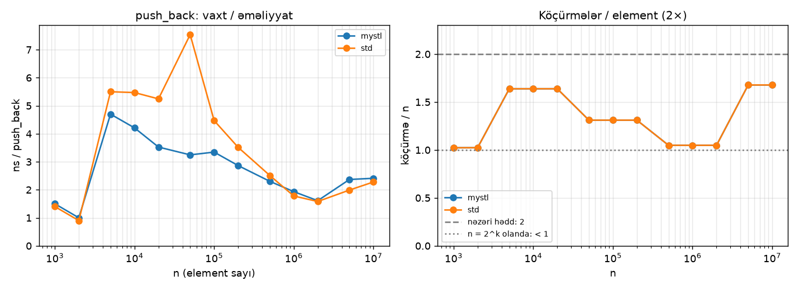
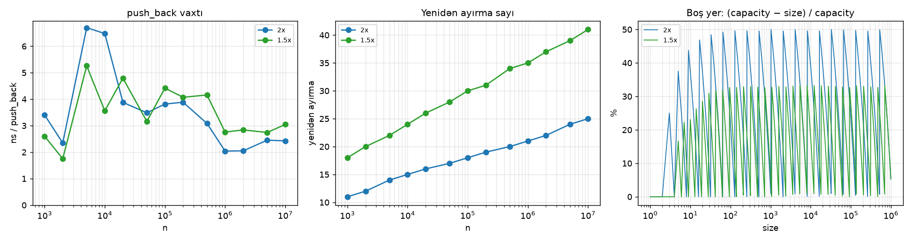
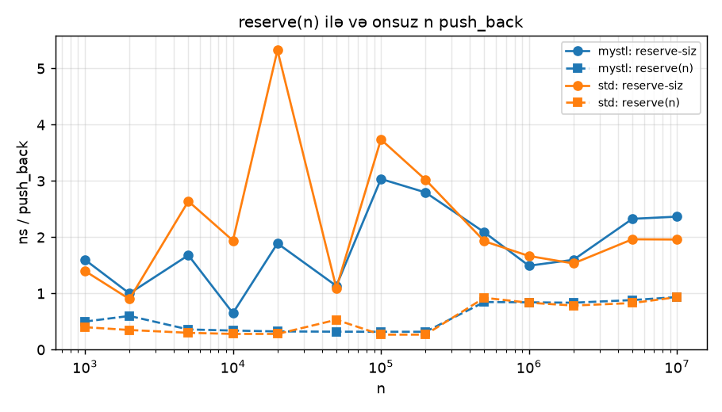
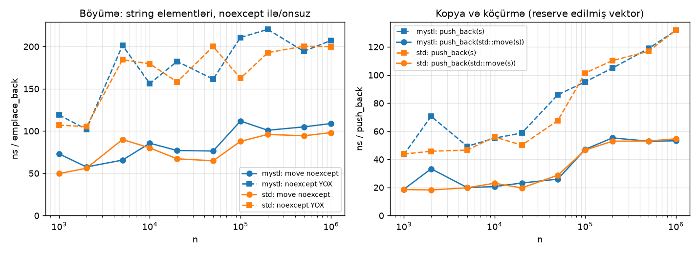
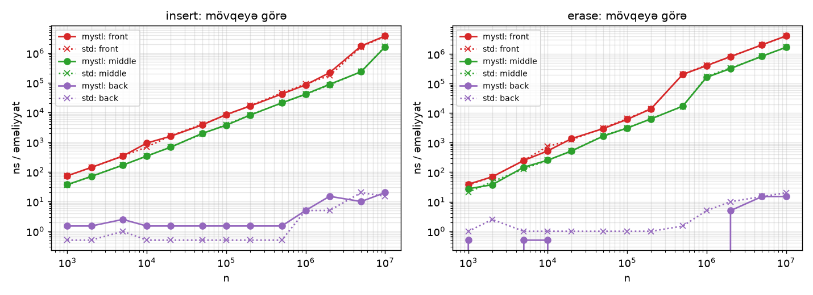
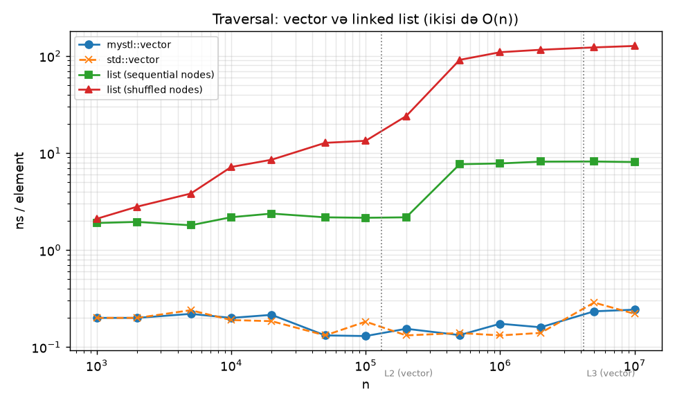
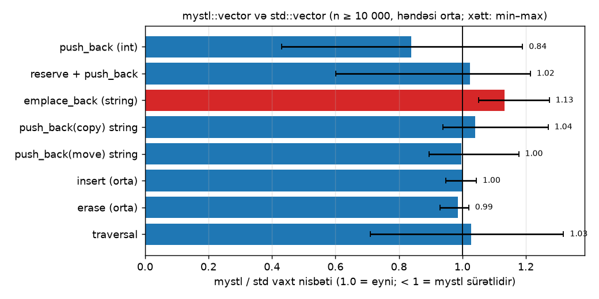
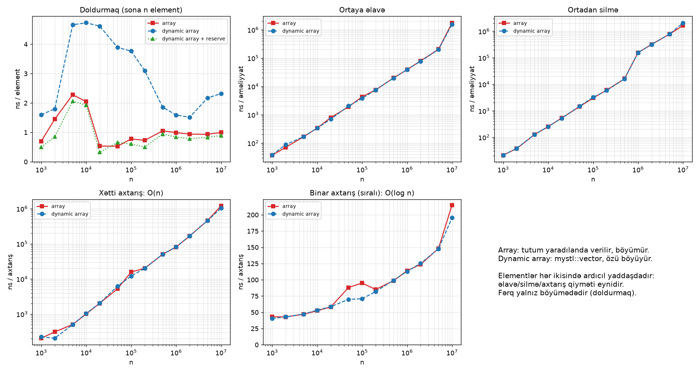

# Faza D: Benchmark və 7 tədqiqat sualı

**Fayllar:**
- [`bench/benchmarks.cpp`](../../bench/benchmarks.cpp), [`bench/bench_common.hpp`](../../bench/bench_common.hpp): ölçmə proqramı
- [`scripts/plot_benchmarks.py`](../../scripts/plot_benchmarks.py): qrafiklər və xülasə
- [`docs/benchmark/data/`](../benchmark/data): xam nəticələr (CSV)
- [`docs/benchmark/summary.md`](../benchmark/summary.md): avtomatik yaradılan rəqəm cədvəlləri

## 1. Metodologiya

| Qayda (yol xəritəsi) | Necə edilib |
|---|---|
| Yalnız Release build, sanitizer-siz | `cmake --preset release`: `-O2`, `MYSTL_SANITIZE=OFF` |
| `std::chrono::steady_clock` | `bench_common.hpp`: `median_ns` |
| Ən azı 5 təkrar, median, əvvəlcə ısınma | 1 ısınma + **9 təkrar**, median götürülür |
| İstifadə olunmayan kodun silinməsinin qarşısını almaq | hər nəticə `g_sink`-ə əlavə olunur, sonda çap edilir |
| n: 10³ … 10⁷, loqarifmik addım | 1, 2, 5, 10, 20, 50, … (onluq başına 3 nöqtə) |
| C++ CSV yazır, Python qrafik çəkir | `docs/benchmark/data/*.csv` → `plot_benchmarks.py` → `q1.png … q7.png` |
| Hər sualda `std::vector` müqayisə xətti | bütün ölçmələr hər iki implementasiya üçün aparılır |

**Median niyə?** Ölçmələrə OS-in kəsmələri, CPU tezliyinin dəyişməsi və digər proqramlar təsir edir. Belə təsirlər bəzi ölçmələri çox yavaş edir. Median bu "outlier"-lərə həssas deyil, orta qiymət isə həssasdır.

**Hazırlıq ölçmədən kənardır.** Məsələn, `insert` testində `n` elementli vektorun qurulması ölçülmür. `median_ns_with_setup` yalnız yoxlanılan əməliyyatın vaxtını götürür.

### Avadanlıq və proqram təminatı

| | |
|---|---|
| Prosessor | AMD Ryzen 7 PRO 5850U, 8 nüvə / 16 axın (noutbuk) |
| Cache | L1d 32 KB / nüvə, L2 512 KB / nüvə, L3 16 MB (ortaq) |
| RAM | 31 GB |
| Əməliyyat sistemi | Windows 11 Pro 23H2 (10.0.22631) |
| Kompilyator | g++ 16.2.0 (MinGW-w64, UCRT, WinLibs), `-std=c++20 -O2` |
| Standart kitabxana | libstdc++ (müqayisə üçün `std::vector`) |

**Məhdudiyyət:** ölçmələr noutbukda, adi iş rejimində aparılıb. Proses müəyyən nüvəyə bağlanmayıb və CPU tezliyi sabitlənməyib. Ona görə tək bir nöqtədə ±20–30% səs-küy ola bilər. Nəticələr tək nöqtəyə görə yox, **trendlərə** və çox nöqtənin ortasına görə şərh olunur.

### Necə təkrarlamaq

```
cmake --preset release
cmake --build --preset release --target benchmarks
build/release/benchmarks.exe --repeats=9
python scripts/plot_benchmarks.py
```

Tam ölçmə bu kompüterdə ~65 saniyə çəkir. `--quick` rejimi n ≤ 10⁵ ilə işləyir (~2 s).

---

## Sual 1: `push_back` həqiqətən amortized O(1)-dirmi?



**Necə ölçülüb:**
- **Sol qrafik:** `n` dəfə `push_back` edilir və ümumi vaxt `n`-ə bölünür.
- **Sağ qrafik:** element tipi köçürmə sayğacı ilə əvəz olunub (`Counted`). Böyümə zamanı edilən köçürmələrin sayı `n`-ə bölünür.

**Nəticə:**

| n | mystl ns/op | std ns/op | köçürmə / n |
|---|---|---|---|
| 1 000 | 1.50 | 1.40 | 1.023 |
| 10 000 | 4.21 | 5.47 | 1.638 |
| 100 000 | 3.35 | 4.47 | 1.311 |
| 1 000 000 | 1.93 | 1.78 | 1.049 |
| 10 000 000 | 2.41 | 2.28 | 1.678 |

**Şərh:**
- `n` 10 000 dəfə artanda əməliyyat başına vaxt **artmır**: 1–5 ns arasında qalır. O(n) olsaydı, 10 000 dəfə artardı. Bu, **amortized O(1)**-in təcrübi sübutudur.
- Köçürmə sayı həmişə **`2n`-dən azdır**. Nəzəriyyə ilə dəqiq uyğundur: son capacity `C < 2n`, köçürmələr `C/2 + C/4 + … + 1 = C − 1`. Məsələn, `n = 10⁷` üçün `C = 2²⁴ = 16 777 216` və köçürmələr `16 777 215`, yəni `1.678 n`.
- Sağ qrafikin "pilləli" forması da nəzəriyyədən gəlir. `n` 2-nin qüvvətindən bir az böyük olanda nisbət ~2-yə yaxınlaşır, bir az kiçik olanda ~1-ə.
- `std::vector`-un köçürmə sayı **eynidir**: libstdc++ da 2× böyüyür. Qrafikdə iki xətt üst-üstə düşür.
- Sol qrafikdə 5 000–50 000 aralığındakı "təpə" allokatorun və cache-in təsiridir: bu ölçülərdə köhnə və yeni buffer-lər cache-ə sığmır, amma yaddaş hələ Windows heap-inin kiçik blok hovuzundan gəlmir. Təpə hər iki implementasiyada var, ona görə vektorun alqoritmindən asılı deyil.

**Cavab: bəli.** Ayrı-ayrı `push_back`-lərin bəziləri O(n)-dir, amma `n` əməliyyatın ümumi işi O(n), yəni əməliyyat başına sabitdir.

---

## Sual 2: Growth factor 2× və 1.5×: hansı yaxşıdır?



**Necə ölçülüb:** eyni `push_back` testi `mystl::vector<int, growth::doubling>` və `mystl::vector<int, growth::one_and_half>` üçün aparılıb (B6-da əlavə olunan parametr). Ölçülənlər: vaxt, yenidən ayırma sayı, köçürmə sayı və boş qalan yaddaş. Boş yer 1-dən 1 000 000-a qədər hər ölçü üçün hesablanıb.

**Nəticə:**

| | 2× | 1.5× |
|---|---|---|
| ns/op, n = 10⁶ | 2.04 | 2.76 |
| ns/op, n = 10⁷ | 2.43 | 3.05 |
| yenidən ayırma, n = 10⁷ | 25 | 41 |
| köçürmə / n, n = 10⁷ | 1.68 | 2.39 |
| **orta** boş yer (1 … 10⁶) | 26.1% | **17.4%** |
| **ən pis** boş yer | 50.0% | **33.3%** |

**Şərh:**
- **Vaxt:** 2× təxminən **20–35% sürətlidir**: daha az yenidən ayırma (log₂ n və log₁.₅ n) və daha az köçürmə edir.
- **Yaddaş:** 1.5× ortalama **~9 faiz bəndi az** boş yer saxlayır, ən pis halda isə 50% əvəzinə 33%.
- Boş yerin "mişar" forması (sağ qrafik) gözləniləndir. Yenidən ayırmadan dərhal sonra boş yer maksimum olur (2× üçün 50%, 1.5× üçün 33%), sonra vektor doldurulduqca 0-a enir.
- **Köhnə blokların təkrar istifadəsi** (B6-da izah olunan nəzəri üstünlük) burada ölçülmür, çünki onun təsiri allokatorun davranışından asılıdır.

**Cavab:** universal "yaxşı" yoxdur, bu bir **trade-off-dur**. Sürət vacibdirsə, 2× (libstdc++, libc++). Yaddaş vacibdirsə, 1.5× (MSVC, folly). Hər ikisi amortized O(1) verir.

---

## Sual 3: `reserve` nə qədər qazandırır?



**Necə ölçülüb:** `n` dəfə `push_back`, bir halda əvvəlcədən `reserve(n)` ilə, digər halda onsuz.

**Nəticə:**

| n | reserve-siz | `reserve(n)` | sürətlənmə (mystl) | sürətlənmə (std) |
|---|---|---|---|---|
| 10 000 | 0.65 ns | 0.34 ns | 1.9× | 6.9× |
| 100 000 | 3.04 ns | 0.32 ns | **9.5×** | 14.0× |
| 1 000 000 | 1.49 ns | 0.84 ns | 1.8× | 2.0× |
| 10 000 000 | 2.37 ns | 0.93 ns | 2.5× | 2.1× |

**Şərh:**
- `reserve` ilə **heç bir yenidən ayırma və köçürmə olmur**, `push_back` sadəcə yazmaq və saymaq olur. Ona görə həmişə sürətlidir.
- Qazanc **1.8×-dən 14×-ə qədər** dəyişir. Ən böyük qazanc yenidən ayırmanın ən baha olduğu orta ölçülərdədir (10⁴–10⁵, Sual 1-dəki "təpə").
- Böyük `n`-də (10⁶+) `reserve` ilə də vaxt ~0.9 ns-ə qalxır. Burada darboğaz yaddaşın özüdür: OS hər yeni səhifəni ilk toxunuşda verir (page fault), RAM-ın sürəti də məhduddur.
- 10 000-dəki fərq (1.9× və 6.9×) mütləq vaxtı çox kiçik olan (~3–20 μs) ölçmənin səs-küyüdür.

**Cavab:** elementlərin sayı əvvəlcədən məlumdursa, `reserve` **ən azı 2 dəfə**, bəzən 10 dəfədən çox qazandırır. Üstəlik, iterator-ları etibarlı saxlayır (B6).

---

## Sual 4: Copy ilə move fərqi nədir? `noexcept` unudulanda nə baş verir?



**Necə ölçülüb:**
- **Sol qrafik:** 40 simvolluq sətirlər (SSO-ya sığmır, heap-dədir) `emplace_back` ilə əlavə olunur. Böyümə zamanı köhnə elementlərin necə daşındığı iki tip ilə müqayisə edilir. Bu tiplər **yalnız** move constructor-un `noexcept` olub-olmaması ilə fərqlənir (`NoexceptMoveString` və `ThrowingMoveString`).
- **Sağ qrafik:** `reserve` edilmiş vektora `push_back(s)` (kopya) və `push_back(std::move(s))` (köçürmə).

**Nəticə (n = 1 000 000):**

| | mystl | std |
|---|---|---|
| move `noexcept` ilə | 109 ns/op | 98 ns/op |
| `noexcept` **unudulub** | 207 ns/op | 200 ns/op |
| **fərq** | **1.9×** | **2.0×** |
| `push_back(s)`: kopya | 132 ns | 132 ns |
| `push_back(std::move(s))`: köçürmə | 53 ns | 55 ns |
| **fərq** | **2.5×** | **2.4×** |

**Şərh:**
- **`noexcept` olmayanda vektor 2 dəfə yavaşlayır.** Böyümə zamanı `std::move_if_noexcept` (A5) köçürmək əvəzinə **kopyalamağı** seçir: hər sətir üçün yeni heap yaddaşı ayrılır və 40 simvol kopyalanır. `noexcept` ilə isə yalnız pointer götürülür.
- Kod düzgün işləyir, heç bir xəta yoxdur. Fərq **səssizdir**, yalnız ölçmə ilə görünür.
- `std::vector`-da da **tam eyni** davranış var. Bu, standartın tələbidir, bizim implementasiyanın xüsusiyyəti deyil.
- Kopya və köçürmə fərqi (sağ qrafik) ~2.5×-dir. Kopya `malloc` + `memcpy` edir, köçürmə isə 3 pointer/ədəd dəyişir.

**Cavab:** sətirlər üçün köçürmə kopyadan ~2.5 dəfə ucuzdur. Move constructor-da `noexcept`-i unutmaq vektoru **2 dəfə yavaşladır**. Bu, öz tiplərimizdə `noexcept` yazmağın praktik səbəbidir.

---

## Sual 5: Ortaya `insert`/`erase` praktikada nə qədər bahadır?



**Necə ölçülüb:** `n` elementli `int` vektoruna əvvələ, ortaya və sona `insert`, sonra eyni mövqelərdən `erase`. Vektora əvvəlcədən `reserve` edilib ki, yalnız elementlərin **sürüşdürülməsi** ölçülsün, yenidən ayırma yox.

**Nəticə (bir əməliyyat):**

| n | əvvələ `insert` | ortaya `insert` | sona `insert` |
|---|---|---|---|
| 1 000 | 74 ns | 37 ns | 2 ns |
| 100 000 | 8.5 μs | 3.7 μs | 2 ns |
| 10 000 000 | **3.76 ms** | 1.61 ms | 20 ns |

**Şərh:**
- Əvvələ və ortaya əlavə **O(n)**-dir. Qrafikdə log-log miqyasda düz xətt alınır: `n` 100 dəfə artanda vaxt da ~100 dəfə artır.
- **Orta əvvəlin yarısıdır:** yalnız sağdakı yarı sürüşdürülür. Nəzəriyyə ilə dəqiq uyğundur.
- **Son O(1)-dir:** heç nə sürüşdürülmür, ölçülə bilməyəcək qədər sürətlidir (ns-in kəsrləri).
- `erase` eyni xarakterdədir (sağ qrafik).
- 10⁷ elementli vektorun əvvəlinə **bir** element əlavə etmək ~4 ms çəkir. Bu müddətdə ~2 milyon `push_back` etmək olar.
- `mystl` və `std` arasında fərq yoxdur (nisbət 0.95–1.04): ikisi də sürüşdürmə üçün `std::move_backward`/`std::move` istifadə edir, bu da `int` üçün `memmove`-a çevrilir.

**Cavab:** ortaya əlavə və silmə praktikada da xətti qiymətlidir. Böyük vektorlarda millisaniyələrlə ölçülür. Əvvələ tez-tez əlavə etmək lazımdırsa, vektor yanlış seçimdir (`std::deque` daha uyğundur).

---

## Sual 6: Cache-in təsiri nə qədərdir?



**Necə ölçülüb:** bütün elementlərin cəmi (traversal). İkisi də O(n)-dir, fərq yalnız yaddaşdakı yerləşmədədir:
- **vector**: elementlər ardıcıl, 4 bayt aralıqla;
- **list (ardıcıl düyünlər)**: sadə tək əlaqəli siyahı, düyünlər ayrılma sırası ilə birləşdirilib (yaddaşda təxminən ardıcıl);
- **list (qarışıq düyünlər)**: eyni düyünlər **təsadüfi sırada** birləşdirilib. Bu, uzun müddət işləmiş proqramın "dağınıq" heap-ini təqlid edir.

**Nəticə (element başına):**

| n | vector | list (ardıcıl) | list (qarışıq) | qarışıq / vector |
|---|---|---|---|---|
| 1 000 | 0.20 ns | 1.9 ns | 2.1 ns | 10× |
| 100 000 | 0.13 ns | 2.2 ns | 13.4 ns | 103× |
| 1 000 000 | 0.17 ns | 7.8 ns | 109 ns | **628×** |
| 10 000 000 | 0.24 ns | 8.1 ns | 127 ns | 522× |

**Şərh:**
- **Vector bütün ölçülərdə ~0.2 ns/element-dir.** Prosessor növbəti elementləri əvvəlcədən cache-ə gətirir (**prefetch**), çünki ünvanlar ardıcıldır. Kompilyator dövrü SIMD ilə də sürətləndirə bilir.
- **Linked list həmişə yavaşdır**, hətta düyünlər ardıcıl olanda da (~10×): hər addımda növbəti ünvanı bilmək üçün əvvəlki düyünü oxumaq lazımdır (**pointer chasing**), prefetch işləmir.
- **Qarışıq list-də cache uçurumu** var: ~2·10⁵ elementdən sonra vaxt kəskin artır. Düyün yaddaşda ~32 bayt tutur (16 bayt məlumat + allokatorun əlavəsi), ona görə ~5·10⁵ düyün L3-ü (16 MB) doldurur. Bundan sonra hər addım **RAM-a müraciətdir** (~100 ns).
- Qrafikdəki şaquli xətlər **vektor** üçün L2 və L3 həddləridir (`int` = 4 bayt). List həmin həddlərə ~8 dəfə tez çatır.

**Cavab:** ikisi də O(n) olsa da, real vaxtda fərq **10 dəfədən 600 dəfəyə qədərdir**. Asimptotik mürəkkəblik bütün həqiqəti göstərmir: yaddaşın yerləşməsi (locality) eyni dərəcədə vacibdir.

---

## Sual 7: `mystl::vector` `std::vector`-a nə qədər yaxındır?



**Necə ölçülüb:** 1–6-cı sualların hər birində `std::vector` eyni şəraitdə ölçülüb. Hər əməliyyat üçün `n ≥ 10 000` olan bütün nöqtələrdə `mystl / std` vaxt nisbəti hesablanıb və onların **həndəsi ortası** götürülüb. Qrafikdəki xətt min–max aralığıdır.

**Həndəsi orta niyə?** Nisbətlər üçün düzgün ortadır: 2× sürətli və 2× yavaş nəticələrin həndəsi ortası 1.0-dır, ədədi ortası isə 1.25.

**İlk cəhddə** yalnız `n = 10⁶` nöqtəsi götürülmüşdü. `insert` və traversal 1.3–1.4× yavaş çıxdı, halbuki qonşu nöqtələrdə (10⁵ və 10⁷) nisbət ~1.0 idi. Bu, tək nöqtənin səs-küyə nə qədər həssas olduğunu göstərdi. Ona görə metod çox nöqtənin həndəsi ortasına dəyişdirildi və təkrar sayı 5-dən 9-a qaldırıldı.

**Nəticə:**

| əməliyyat | mystl / std | min – max |
|---|---|---|
| `push_back` (`int`) | 0.84 | 0.43 – 1.19 |
| `reserve` + `push_back` | 1.02 | 0.60 – 1.21 |
| `emplace_back` (`string`) | **1.13** | 1.05 – 1.27 |
| `push_back(copy)` (`string`) | 1.04 | 0.94 – 1.27 |
| `push_back(move)` (`string`) | 1.00 | 0.90 – 1.18 |
| ortaya `insert` | 1.00 | 0.95 – 1.04 |
| ortadan `erase` | 0.99 | 0.93 – 1.02 |
| traversal | 1.03 | 0.71 – 1.32 |

**Şərh:**
- Əksər əməliyyatlarda fərq **±5%-dən azdır**, ölçmənin səs-küyü səviyyəsindədir.
- `push_back` (`int`) ortalama bir az **sürətli** çıxdı (0.84), amma aralıq geniş olduğu üçün (0.43–1.19) bunu "daha sürətli" kimi iddia etmək olmaz. Daha düzgün nəticə: **eyni səviyyədədir**.
- `emplace_back` (`string`) ardıcıl olaraq ~**10% yavaşdır** (minimum belə 1.05-dir). Ehtimal olunan səbəb böyümə yolundakı fərqdir: bizim `reallocate_with_tail` hər element üçün ayrıca `move_if_noexcept` dövrü və iki `try/catch` blokundan istifadə edir. libstdc++ isə daha optimallaşdırılmış relocation funksiyaları işlədir. Dəqiq səbəb profiler ilə araşdırılmayıb. Bu, gələcək iş kimi qeyd olunur.

**Cavab:** `mystl::vector` `std::vector` ilə **praktik olaraq eyni sürətdədir**: 8 əməliyyatdan 7-sində fərq səs-küy səviyyəsindədir, birində ~10% yavaşdır.

---

## Sual 8 (əlavə): Array və Dynamic Array: əlavə, silmə, axtarış



**Niyə əlavə olunub?** Bu sual kursun "Array və Dynamic Array" mövzusu üçündür: əlavə, silmə və axtarış vaxtını müxtəlif həcmlərdə ölçüb müqayisə etmək.

**Necə ölçülüb:** iki struktur müqayisə olunur.
- **Array** (`FixedArray`, [`bench/benchmarks.cpp`](../../bench/benchmarks.cpp)): tutumu yaradılanda **bir dəfə** verilir və heç vaxt böyümür. Ortaya əlavə və silmə əl ilə sürüşdürmə ilə yazılıb. Doludursa, əlavə mümkün deyil.
- **Dynamic Array**: `mystl::vector<int>`, özü böyüyür.

Hər `n` üçün (10³…10⁷) beş əməliyyat ölçülüb:
1. **doldurmaq:** sona `n` element (dynamic array həm `reserve` ilə, həm onsuz);
2. **ortaya əlavə;**
3. **ortadan silmə;**
4. **xətti axtarış:** `std::find`, təsadüfi açarlar (seed 7);
5. **binar axtarış:** `std::binary_search`, elementlər sıralıdır.

**Nəticə:**

| n | əməliyyat | Array | Dynamic Array | Dynamic Array + `reserve` |
|---|---|---|---|---|
| 1 000 | doldurmaq (ns/element) | 0.70 | 1.60 | 0.50 |
| 100 000 | doldurmaq (ns/element) | 0.78 | **3.77** | 0.61 |
| 10 000 000 | doldurmaq (ns/element) | 1.00 | **2.32** | 0.89 |
| 100 000 | ortaya əlavə | 4.3 μs | 3.8 μs | – |
| 100 000 | ortadan silmə | 3.0 μs | 3.2 μs | – |
| 100 000 | xətti axtarış | 15.7 μs | 12.1 μs | – |
| 100 000 | binar axtarış | 95 ns | 71 ns | – |
| 10 000 000 | ortaya əlavə | 1.74 ms | 1.55 ms | – |
| 10 000 000 | xətti axtarış | 1.19 ms | 1.03 ms | – |
| 10 000 000 | binar axtarış | 215 ns | 195 ns | – |

**Şərh:**
- **Əlavə, silmə və axtarışın qiyməti eynidir.** Qrafikdə xətlər üst-üstə düşür. Səbəb: hər iki strukturda elementlər **ardıcıl yaddaşdadır**. Ortaya əlavə və silmə hər ikisində eyni sürüşdürməni (O(n)), axtarış isə eyni keçidi edir. Kiçik fərqlər (±10–25%) ölçmənin səs-küyüdür.
- **Mürəkkəbliklər nəzəriyyəyə uyğundur:** ortaya əlavə və silmə O(n) (log-log qrafikdə düz xətt), xətti axtarış O(n), binar axtarış O(log n): `n` 10 000 dəfə artanda vaxt cəmi ~5 dəfə artır (43 ns → 215 ns).
- **Yeganə fərq böyümədədir (doldurmaq):** `reserve`-siz dinamik massiv 2–5 dəfə yavaşdır, çünki dolanda yeni buffer ayırıb elementləri köçürür (Sual 1). `reserve` ilə isə adi massiv qədər sürətlidir, hətta bir az sürətli.
- **Qiymətə görə nə alırıq?** Array-in ölçüsünü **əvvəlcədən bilmək** lazımdır. Testdə ortaya əlavə üçün massivə əvvəlcədən `n + ops` yer ayrılıb, əks halda əlavə mümkün olmazdı. Dynamic array isə ölçünü bilmədən işləyir, bunun qiyməti böyümə zamanı amortized O(1) əlavə işdir.

**Cavab:** Array ilə Dynamic Array arasında əlavə, silmə və axtarış sürəti **eynidir**, çünki ikisinin də yaddaş quruluşu eynidir. Dynamic array-in yeganə əlavə xərci böyümədir, o da `reserve` ilə aradan qalxır. Ölçü məlum deyilsə, dynamic array seçilir. Ölçü tam məlumdursa və heç vaxt dəyişmirsə, adi array kifayətdir.

---

## Yekun

| # | Sual | Qısa cavab |
|---|---|---|
| 1 | `push_back` amortized O(1)? | **Bəli.** ns/op `n`-dən asılı deyil, köçürmə < 2n |
| 2 | 2× və 1.5×? | **Trade-off:** 2× ~25% sürətli, 1.5× ~9 faiz bəndi az yaddaş itirir |
| 3 | `reserve`-in qazancı? | **2–14×** |
| 4 | copy/move, `noexcept`? | move ~2.5× ucuz; `noexcept` unudulanda **2× yavaşlama** |
| 5 | ortaya `insert`/`erase`? | **O(n)**: 10⁷-də bir əməliyyat ~4 ms; sonda O(1) |
| 6 | cache-in təsiri? | eyni O(n) traversal-da **10–600×** fərq |
| 7 | `std::vector`-a yaxınlıq? | **Praktik olaraq eyni**: 7/8 əməliyyatda ±5%, `emplace_back(string)` ~10% yavaş |
| 8 | Array və Dynamic Array? | əlavə/silmə/axtarış **eyni**; fərq yalnız böyümədə (`reserve`-siz 2–5×) |

## Müdafiədə gələ biləcək suallar

**Niyə median, orta yox?** Ölçmələrə OS və CPU tezliyi təsir edir, bəzi ölçmələr təsadüfən çox yavaş olur. Median belə "outlier"-lərə həssas deyil.

**Kompilyatorun kodu silməsinin qarşısını necə aldınız?** Hər ölçmənin nəticəsi qlobal `g_sink` dəyişəninə əlavə olunur və proqramın sonunda çap edilir. Nəticə istifadə olunduğu üçün kompilyator hesablamanı silə bilmir.

**Vector nə vaxt linked list-dən pis seçimdir?** Əvvələ və ya ortaya tez-tez əlavə/silmə lazım olanda və elementlərə iterator/pointer-lərin dəyişməz qalması tələb olunanda. Amma traversal-da list 10–600 dəfə yavaşdır, ona görə praktikada vector çox vaxt yenə də qalib gəlir.

**Nəticələriniz nə qədər etibarlıdır?** Noutbukda, CPU tezliyi sabitlənmədən ölçülüb, ona görə tək nöqtədə ±20–30% səs-küy ola bilər. Nəticələr trendlərə və çox nöqtənin ortasına əsaslanır. Bunun nümunəsi Sual 7-də tək nöqtənin necə yanıltdığıdır. Bütün xam məlumatlar CSV-dədir və ölçmə bir əmrlə təkrarlana bilər.
